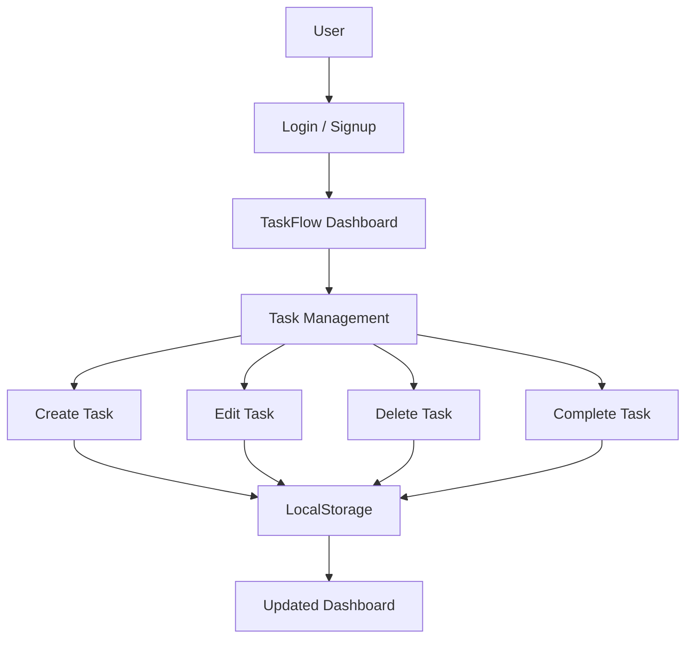

# TaskFlow – SaaS Task Management Application

TaskFlow is a responsive task management web application built using React and Vite. It helps users organize daily activities, manage priorities, track progress, and improve productivity through a clean dashboard.

## Live Demo

Coming Soon – Deployment in Progress.

## Features

- Demo Login and Signup Authentication
- Interactive Dashboard
- Create, Read, Update and Delete Tasks (CRUD)
- Task Completion and Reopening
- Search Tasks Dynamically
- Filter Tasks by Status and Priority
- Task Categories and Due Dates
- Automatic Statistics
- Overdue Task Tracking
- LocalStorage Data Persistence
- Responsive Desktop and Mobile UI
- Toast Notifications

## Tech Stack

- React.js
- JavaScript (ES6+)
- Vite
- HTML5
- CSS3
- Lucide React
- Browser LocalStorage

## Project Architecture

```text
taskflow-capstone/
│
├── public/
│
├── src/
│   ├── assets/
│   ├── App.jsx
│   ├── App.css
│   ├── index.css
│   └── main.jsx
│
├── index.html
├── package.json
├── package-lock.json
├── vite.config.js
└── README.md
```

## Application Flow



## Installation and Setup

### 1. Clone Repository

```bash
git clone https://github.com/kanhaiyamm55-cmd/taskflow-capstone.git
```

### 2. Open Project

```bash
cd taskflow-capstone
```

### 3. Install Dependencies

```bash
npm install
```

### 4. Start Development Server

```bash
npm run dev
```

### 5. Production Build

```bash
npm run build
```

## Data Persistence

TaskFlow uses browser LocalStorage to save user demo information and task data. Data remains available after refreshing the browser on the same browser profile.

## Authentication Notice

This project implements simulated authentication for demonstration purposes. It does not provide real server-side authentication or password security.

## Deployment

The production build is generated in the `dist` directory and can be deployed using Vercel or Netlify.

## Future Improvements

- Backend API Integration
- MongoDB Database
- Secure User Authentication
- Team Collaboration
- Cloud Data Synchronization
- Task Analytics

## Author

Kanhaiya Mishra

BCA Student | Web Developer

GitHub: https://github.com/kanhaiyamm55-cmd

## License

This project is developed for educational and portfolio purposes.
